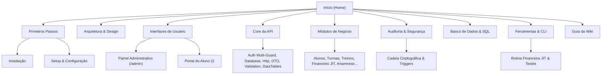

# LTD - C.T - Documentação & Wiki do Projeto

Bem-vindo ao portal de documentação do **LTD - C.T (Cross C.T - Centro de Treinamento)**. Este espaço centraliza toda a arquitetura, manuais operacionais, especificações da API, modelagem do banco de dados e rotinas do sistema.

> [!TIP]
> Para navegar na documentação interativa da API REST com execução de testes ao vivo, acesse o **Swagger UI** local em [`http://localhost/ctt/api/docs`](http://localhost/ctt/api/docs) ou leia o [Módulo Docs](modules/docs.md).

---

## Mapa da Documentação

A documentação está estruturada em tópicos para atender desenvolvedores, administradores e operadores:

---

## Seções da Wiki

### 1. Primeiros Passos & Implantação
- **[Guia de Instalação](instalacao.md)**: Requisitos do sistema, dependências PHP (Composer), Node.js (MJML), assets de interface versionados e ambiente local (XAMPP).
- **[Setup da Aplicação](setup.md)**: Criação do banco de dados, usuário de serviço `ctt_app`, variáveis de ambiente `.env`, validação inicial e configuração de produção com DocumentRoot em `public/`.
- **[Configuração de E-mail](modules/auth-email.md)**: Integração com SMTP / PHPMailer e compilação de templates responsivos (ativação de conta, senha inicial e redefinição).

### 2. Arquitetura & Fundamentos
- **[Arquitetura do Sistema](arquitetura.md)**: Estilo arquitetural em camadas (`Controller -> Service -> Repository -> Database`), separação de contextos, fluxo de requisições, multi-guards e segurança.
- **[Core da API](core/README.md)**: Módulos fundamentais e reutilizáveis da infraestrutura HTTP e de dados.
- **[Documentação da API (Swagger / OpenAPI)](core/docs.md)**: Especificação OpenAPI 3.0.3 e interface interativa Swagger UI com suporte nativo a sessão e CSRF.

### 3. Interfaces de Usuário
- **[Painel Administrativo](admin/README.md)**: Funcionamento do `AdminRouter`, controle de acesso RBAC, estrutura de views/partials e integração com a API via Fetch API e DataTables.
- **[Portal do Aluno](aluno/README.md)**: Ambiente exclusivo para alunos com login por e-mail ou matrícula, consulta de planos, grade de horários, avaliações físicas e faturas.

### 4. Infraestrutura & Core da API
| Componente | Descrição | Documento |
| :--- | :--- | :--- |
| **Auth** | Multi-guard (`admin` e `aluno`), controle de sessão, tokens CSRF e rate limit | [Ver doc](core/auth.md) |
| **Database** | Conexão singleton PDO, transações e queries preparadas | [Ver doc](core/database.md) |
| **Http** | Roteador RESTful, abstração de Request e Response JSON | [Ver doc](core/http.md) |
| **Repository** | Abstração da camada de persistência e isolamento do SQL | [Ver doc](core/repository.md) |
| **Services** | Regras de negócio, transações e validações de domínio | [Ver doc](core/services.md) |
| **DTO** | Objetos de transferência de dados tipados e sanitizados | [Ver doc](core/dto.md) |
| **Validation** | Validação desacoplada de formulários e payloads | [Ver doc](core/validation.md) |
| **DataTables** | Padronização de paginação, busca e ordenação server-side | [Ver doc](core/datatables.md) |

### 5. Módulos de Negócio
- **[Índice dos Módulos](modules/README.md)**: Panorama de todos os módulos da aplicação.
- **Pessoas & Acesso**: [Usuários](modules/usuario.md) • [Funcionários](modules/funcionario.md) • [Cargos & Permissões](modules/cargo.md) • [Autenticação](modules/auth.md)
- **Operação & Treinamento**: [Alunos](modules/aluno.md) • [Turmas](modules/turma.md) • [Treinos](modules/treino.md) • [Modalidades](modules/modalidade.md) • [Locais & Espaços](modules/local.md)
- **Saúde & Físico**: [Anamnese](modules/anamnese.md) • [Avaliação Física](modules/avaliacao.md)
- **Financeiro**: [Contratos, Cobranças JIT, Planos & Pagamentos](modules/financeiro.md)
- **Gestão & Relatórios**: [Relatórios Gerenciais](modules/relatorio.md)

### 6. Auditoria & Segurança
- **[Arquitetura de Auditoria](modules/auditoria.md)**: Trilha imutável em blockchain interna (cadeia de hashes SHA-256), integridade e não repúdio.
- **[Catálogo de Eventos](modules/auditoria_eventos.md)**: Mapeamento de todas as ações auditadas pelo sistema e gatilhos de banco.
- **[Operação & Verificação](modules/auditoria_operacoes.md)**: Instalação de permissões restritas e verificação periódica de integridade.

### 7. Banco de Dados & Scripts
- **[Estrutura do Banco de Dados](database/README.md)**: Diagrama relacional, tabelas, convenções e relacionamentos.
- **Scripts SQL**:
  - `docs/sql/setup/banco.sql`: Estrutura base completa com gatilhos.
  - `docs/sql/auditoria_permissoes.sql`: Concessão estrita de privilégios para `ctt_app`.
  - `docs/sql/migrations/`: Atualizações (incluindo `cobrancas_dinamicas_jit.sql` e `permissoes_sistema.sql`).
  - `docs/sql/testes/`: Seeds para cenários de desenvolvimento e homologação.

### 8. Ferramentas & Rotinas
- **[Guia de Ferramentas e CLI](tools/README.md)**:
  - Automação financeira Just-In-Time (JIT) com controle diário via `financeiro_jit_state.json`.
  - Verificador de integridade de auditoria (`tools/sistema/verify_audit.php`).
  - Criador/redefinidor de senha mestre (`tools/sistema/criar_admin.php`).
  - Suíte de testes automatizados (`composer test`).
  - Utilitário de manutenção e upgrade de assets (`tools/download_all_plugins.php`).
  - Sincronizador multiplataforma da documentação com a Wiki (`tools/wiki/sincronizar_wiki.php`).

### 9. Publicação da Wiki no Repositório
- **[Guia de Publicação da Wiki](wiki_guia.md)**: Como ativar e sincronizar esta documentação com a Wiki oficial do repositório no GitHub/GitLab via `sincronizar_wiki.php`.

---

> [!NOTE]
> Esta documentação é versionada em conjunto com o código fonte. Sempre que adicionar uma rota, serviço ou regra de negócio, mantenha a documentação correspondente atualizada.
