# Painel Administrativo

O painel administrativo do **LTD-C.T** concentra a interface gráfica de gestão do centro de treinamento. Ele foi desenvolvido em PHP puro para renderização das views, integrado à API REST via JavaScript assíncrono (Fetch API) e bibliotecas de UI como DataTables.

---

## Arquitetura do Painel

O painel administrativo está localizado no diretório [`admin/`](../../admin/) e possui seu próprio ciclo de vida de requisição:

```mermaid
flowchart LR
    Browser["Navegador (Usuário)"] --> Apache[".htaccess (/admin/*)"]
    Apache --> Index["admin/index.php"]
    Index --> Router["admin/router.php"]
    Router --> Routes["admin/routes/admin.php"]
    Routes --> Middlewares["Middlewares (auth / guest)"]
    Middlewares --> View["admin/views/*.php"]
    View --> JS["public/js/*.js (Fetch API / DataTables)"]
    JS --> API["/ctt/api/ (Endpoints REST)"]
```



### Principais Componentes:
- **`admin/index.php`**: Ponto de entrada das requisições do painel administrativo.
- **`admin/router.php` (`AdminRouter`)**: Roteador amigável customizado baseado em expressões regulares. Permite registrar rotas com parâmetros na URL (ex: `alunos/editar/{id}`) e vincular middlewares.
- **`admin/routes/admin.php`**: Mapeamento central de todas as rotas do painel, closures de inicialização de sessão e middlewares de proteção.
- **`admin/views/`**: Telas em PHP que contêm o HTML e a lógica visual da interface.
- **`admin/views/partials/`**: Elementos reaproveitáveis de layout (header, footer, menu lateral, barra superior).

---

## Sessão, Autenticação e Middlewares

O painel gerencia a autenticação através de sessões nativas do PHP configuradas em `admin/routes/admin.php`:

### Configuração da Sessão
- **Nome do Cookie**: `CTTSESSID`
- **Atributos de Segurança**: `HttpOnly = true`, `SameSite = 'Lax'`, `Path = '/ctt'`.

### Middlewares Disponíveis
1. **`$startSession`**: Inicializa a sessão com cookies seguros se ainda não estiver iniciada.
2. **`$auth`**:
   - Exige que `$_SESSION['user_id']` esteja preenchido.
   - Redireciona usuários não autenticados para `/ctt/admin/login`.
   - Valida o perfil do usuário (`$_SESSION['user_tipo']` deve ser `admin` ou `funcionario`). Usuários com perfil `aluno` são redirecionados para a área de aluno.
3. **`$guest`**:
   - Garante que a tela seja acessada apenas por usuários anônimos (ex: login, esqueci a senha). Se já houver sessão ativa, redireciona para `/ctt/admin/inicio`.
4. **`$logout`**:
   - Destrói completamente a sessão, apaga os cookies de sessão no navegador e redireciona para a tela de login.

---

## Mapa de Telas e Rotas

As rotas são resolvidas a partir do prefixo `/ctt/admin/`:

### 1. Autenticação & Recuperação
| Rota | View correspondente | Middleware | Descrição |
| :--- | :--- | :--- | :--- |
| `login` | `login.php` | `$guest` | Formulário de login |
| `recuperar-senha` | `recuperar-senha.php` | `$guest` | Solicitação de link de redefinição de senha |
| `redefinir-senha` | `redefinir-senha.php` | `$guest` | Formulário de criação de nova senha via token |
| `ativar-conta` | `ativar-conta.php` | `$guest` | Ativação do primeiro acesso do aluno |
| `logout` | *(action)* | `$startSession` | Encerramento de sessão e destruição de cookies |

### 2. Gestão de Alunos & Saúde
| Rota | View correspondente | Middleware | Descrição |
| :--- | :--- | :--- | :--- |
| `alunos` | `alunos.php` | `$auth` | Listagem de alunos com busca e filtros DataTables |
| `alunos/cadastrar` | `aluno_form.php` | `$auth` | Formulário de cadastro de novo aluno |
| `alunos/editar/{id}` | `aluno_form.php` | `$auth` | Edição dos dados cadastrais do aluno |
| `alunos/detalhes/{id}` | `aluno_detalhe.php` | `$auth` | Visão 360 do aluno (dados, turmas, financeiro, histórico) |
| `alunos/avaliacao/{id}`| `avaliacao_form.php` | `$auth` | Cadastro e visualização de avaliação física |

### 3. Gestão de Turmas, Treinos e Espaços
| Rota | View correspondente | Middleware | Descrição |
| :--- | :--- | :--- | :--- |
| `turmas` | `turmas.php` | `$auth` | Listagem de turmas ativas e arquivadas |
| `turmas/cadastrar` | `turma_form.php` | `$auth` | Criação de turma, definição de horários e vagas |
| `turmas/editar/{id}` | `turma_form.php` | `$auth` | Alteração de informações da turma |
| `turmas/gerenciar/{id}`| `gerenciar_turma.php` | `$auth` | Enturmação de alunos e lista de chamada/presença |
| `treinos` | `treinos.php` | `$auth` | Agenda e listagem de treinos diários |
| `treinos/cadastrar` | `treino_form.php` | `$auth` | Criação de novo treino e definição de exercícios |
| `locais` | `locais.php` | `$auth` | Gestão dos espaços físicos de treinamento |
| `locais/cadastrar` | `local_form.php` | `$auth` | Cadastro de novo local de treino |
| `modalidades/cadastrar`| `modalidade_form.php`| `$auth` | Cadastro de modalidades esportivas |

### 4. Gestão Financeira
| Rota | View correspondente | Middleware | Descrição |
| :--- | :--- | :--- | :--- |
| `financeiro` | `financeiro.php` | `$auth` | Dashboard financeiro e listagem de contratos ativos |
| `financeiro/cobrancas` | `financeiro_cobrancas.php` | `$auth` | Gestão de faturas, pagamentos, cancelamentos e estornos |
| `financeiro/planos` | `financeiro_planos.php` | `$auth` | Configuração de planos comerciais |
| `financeiro/servicos` | `financeiro_servicos.php` | `$auth` | Catálogo de serviços prestados |
| `financeiro/contratos/novo` | `contrato_form.php` | `$auth` | Formalização de novo contrato de aluno |

### 5. Equipe, Configurações & Relatórios
| Rota | View correspondente | Middleware | Descrição |
| :--- | :--- | :--- | :--- |
| `funcionarios` | `funcionarios.php` | `$auth` | Listagem de colaboradores e instrutores |
| `funcionarios/cadastrar`| `funcionario_form.php`| `$auth` | Cadastro de novo funcionário |
| `cargos/cadastrar` | `cargo_form.php` | `$auth` | Cadastro de cargos e permissões |
| `relatorios` | `relatorios.php` | `$auth` | Emissão de relatórios operacionais e gerenciais |
| `configuracoes` | `configuracoes.php` | `$auth` | Parâmetros gerais do centro de treinamento |
| `perfil` | `perfil.php` | `$auth` | Dados da conta do usuário autenticado |

---

## Comunicação com a API e Proteção CSRF

As páginas administrativas interagem com os endpoints REST de `/ctt/api/` utilizando chamadas HTTP assíncronas:

1. **Credenciais**: Toda requisição enviada pelo JavaScript inclui `credentials: 'same-origin'` para trafegar a sessão `CTTSESSID`.
2. **Proteção CSRF**:
   - Ao carregar a aplicação, a API define um cookie chamado `CTT_CSRF_TOKEN`.
   - Scripts do front-end lêem este cookie e transmitem o cabeçalho HTTP:
     ```http
     X-CSRF-Token: <token-do-cookie>
     ```
   - Requisições que alteram dados (`POST`, `PUT`, `DELETE`) são recusadas caso este token não confira, impedindo ataques de Cross-Site Request Forgery.
3. **DataTables Server-Side**:
   - As tabelas de listagem utilizam o protocolo DataTables server-side, enviando parâmetros `draw`, `start`, `length`, `search[value]`, e recebendo respostas paginadas diretamente do banco.
