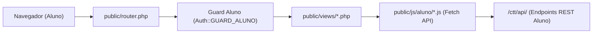

# Portal do Aluno

O Portal do Aluno do **LTD-C.T** concentra a interface web voltada para os praticantes e alunos matriculados no centro de treinamento. Desenvolvido com renderização em PHP e consumo assíncrono da API REST, ele oferece um ambiente exclusivo, intuitivo e responsivo para acompanhamento de treinos, frequência, evolução física e financeiro.

---

## Arquitetura do Portal do Aluno

O portal está localizado no diretório [`public/`](../../public/) e possui ciclo de vida e roteamento independentes do painel administrativo:

### Componentes Principais:
- **`public/router.php` (`PublicRouter`)**: Roteador amigável com suporte a regex, closures e injeção automática de tokens CSRF.
- **`public/views/`**: Telas PHP com HTML semântico e parciais reaproveitáveis (`public/views/partials/`).
- **`public/js/aluno/`**: Scripts assíncronos que conectam a interface aos endpoints da API.

---

## Sessão e Isolamento de Guards

O sistema adota a arquitetura **Multi-Guard** (`Core\Auth\Auth`), garantindo o isolamento completo entre a sessão administrativa e a sessão do aluno:

- **Contexto:** `Auth::setContext(Auth::GUARD_ALUNO)`
- **Sessão:** Cookie `CTTSESSID` com `HttpOnly`, `SameSite=Lax` e proteção estrita contra roubo de sessão.
- **Isolamento:** Um aluno autenticado não tem acesso a rotas do painel admin (`/admin/*`) e administradores não interferem nas credenciais ativas do aluno.

### Métodos de Autenticação Aceitos:
1. **E-mail ou Matrícula:** O aluno pode efetuar login utilizando seu endereço de e-mail ou o **Código de Matrícula** gerado automaticamente pelo sistema (ex: `MAT-2026-00001`).
2. **Ativação de Conta:** Alunos recém-cadastrados recebem um e-mail com link único e token seguro (`/ativar-conta/{token}`) para cadastrar sua senha inicial e ativar a conta.
3. **Proteção Contra Força Bruta:** Rate limiting de 5 tentativas por identificador e 25 tentativas por IP em janelas de 15 minutos.

---

## Mapa de Telas e Rotas

As rotas são resolvidas a partir da raiz pública da aplicação (`BASE_URL`):

| Rota | View correspondente | Proteção | Descrição |
| :--- | :--- | :--- | :--- |
| `/` | `home.php` | Pública | Página institucional inicial com apresentação do CT |
| `/login` | `login.php` | Guest (Não logado) | Formulário de login por e-mail ou matrícula |
| `/ativar-conta/{token}` | `ativar-conta.php` | Pública | Definição de senha do primeiro acesso |
| `/dashboard` | `dashboard.php` | `$studentAuth` | Visão geral: próximos treinos, avisos e status de pagamento |
| `/dados-pessoais` | `dados-pessoais.php`| `$studentAuth` | Consulta dos dados cadastrais, endereço e contatos |
| `/matricula` | `matricula.php` | `$studentAuth` | Detalhes do contrato vigente, plano contratado e vigência |
| `/avaliacoes` | `avaliacoes.php` | `$studentAuth` | Histórico e gráficos de avaliações físicas e corporais |
| `/horarios` | `horarios.php` | `$studentAuth` | Grade de turmas, modalidades e horários de aula |
| `/financeiro` | `financeiro.php` | `$studentAuth` | Faturas abertas, histórico de pagamentos e comprovantes |
| `/logout` | — | `$studentAuth` | Destrói a sessão do aluno e redireciona para o login |

---

## Experiência do Usuário (UI/UX)

- **Layout Mobile-First:** Totalmente responsivo para smartphones e tablets.
- **Tema Visual Moderno:** Design escuro com tipografia Manrope/Inter e ícones Phosphor Icons.
- **Segurança Transparente:** Todas as ações POST na interface possuem envio automático de token CSRF (`X-CSRF-Token`).
