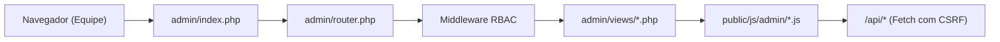
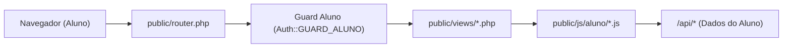
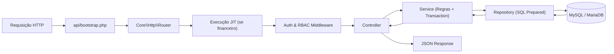

# Arquitetura do Sistema

## Visão Geral

O projeto **LTD-C.T - Centro de Treinamento** é uma aplicação web completa desenvolvida em PHP puro estruturado, executada em ambiente Apache/Nginx (localmente via XAMPP ou em produção com isolamento de diretório público). O sistema possui separação rígida de responsabilidades:

- **Painel Administrativo** em `admin/`: interface para administradores, instrutores e colaboradores;
- **Portal do Aluno** em `public/`: interface exclusiva para alunos e praticantes;
- **API RESTful** em `api/`: regras de negócio, serviços de domínio e persistência;
- **Auditoria Criptográfica**: cadeia imutável estilo blockchain com hashes SHA-256 e gatilhos SQL;
- **Automação Financeira Just-In-Time (JIT)**: geração e vencimento sob demanda na aplicação, sem agendadores externos;
- **Documentação & Especificação** em `docs/` e OpenAPI 3.0 via Swagger UI integrado.

---

## Estilo Arquitetural

O estilo predominante é uma **arquitetura em camadas desacopladas**, orientada a serviços de domínio:

`Controller -> Service -> Repository -> Database`

### Papéis das Camadas:
- **`Controller`**: Borda HTTP. Extrai parâmetros (`$_GET`, `$_POST`, JSON), valida sessão/CSRF, dispara chamadas JIT se aplicável, invoca o serviço de negócio e retorna respostas padronizadas em JSON.
- **`Service`**: Núcleo de domínio. Concentra regras de negócio, cálculos (multa, juros, métricas), orquestração entre múltiplos repositórios e controle transacional atômico (`$this->transaction(...)`).
- **`Repository`**: Camada de persistência. Encapsula comandos SQL, isola nuances do schema e protege contra injeção de SQL via Prepared Statements.
- **`DTO`**: Objetos tipados de transferência de dados que padronizam e sanitizam o transporte entre a borda HTTP e a persistência.
- **`Database`**: Conexão singleton PDO compartilhada com suporte a transações aninhadas.

---

## Estrutura Completa de Diretórios

```text
ctt/
|-- admin/                  # Painel administrativo
|   |-- router.php          # Roteador dedicado do admin (AdminRouter)
|   |-- routes/admin.php    # Mapa de rotas do painel e middlewares RBAC
|   |-- views/              # Telas em PHP do painel
|   `-- index.php           # Front Controller do admin
|-- api/                    # API RESTful em PHP
|   |-- bootstrap.php       # Bootstrap, headers CORS e carregamento do router
|   |-- core/               # Infraestrutura base compartilhada
|   |   |-- Auth/           # Multi-guard (admin/aluno), CSRF, PasswordPolicy e rate limits
|   |   |-- Database/       # Conexão PDO singleton e Repository base
|   |   |-- DataTables/     # Tratamento de busca e paginação server-side
|   |   |-- DTO/            # DTO base
|   |   |-- Http/           # Abstração de Request, Response e Router RESTful
|   |   |-- Services/       # Service base com transactions PDO
|   |   `-- Validation/     # Motor de validação desacoplado
|   |-- routes/api.php      # Mapeamento central de todos os endpoints REST
|   `-- src/                # Módulos organizados por domínio de negócio
|       |-- aluno/          # Cadastro de alunos e matrículas
|       |-- anamnese/       # Fichas médicas e questionários
|       |-- auth/           # Login unificado (e-mail, CPF, matrícula), reset e ativação
|       |-- avaliacao/      # Avaliações físicas antropométricas
|       |-- cargo/          # Gestão de cargos e permissões
|       |-- docs/           # OpenAPI / Swagger UI
|       |-- financeiro/     # Serviços, planos, contratos, cobranças e JIT
|       |-- funcionario/    # Gestão da equipe e instrutores
|       |-- local/          # Espaços de treino e salas
|       |-- modalidade/     # Modalidades esportivas
|       |-- relatorio/      # Relatórios operacionais e consolidações
|       |-- treino/         # Planos de aula, WODs e chamada
|       |-- turma/          # Turmas, grade e enturmação
|       `-- usuario/        # Gestão de credenciais e status
|-- docs/                   # Documentação completa e Wiki do projeto
|   |-- aluno/              # Documentação do Portal do Aluno
|   |-- admin/              # Documentação do Painel Admin
|   |-- core/               # Documentação da infraestrutura
|   |-- modules/            # Manuais detalhados de cada módulo
|   |-- setup/              # VHosts prontos para Apache e Nginx (produção)
|   |-- sql/                # Scripts de banco (setup, migrations, testes)
|   `-- tools/              # Documentação de CLI e rotinas
|-- plugins/                # Dependências offline de front-end (Bootstrap, DataTables, etc.)
|-- public/                 # Portal do Aluno e ativos estáticos
|   |-- router.php          # Roteador dedicado do Portal do Aluno (PublicRouter)
|   |-- views/              # Telas do aluno (dashboard, financeiro, treinos, etc.)
|   |-- css/                # Folhas de estilo da aplicação
|   |-- js/                 # Scripts assíncronos (Fetch API) de admin e aluno
|   `-- index.php           # Ponto de entrada unificado para produção
|-- tools/                  # Utilitários de linha de comando e testes
|   |-- desenvolvimento/    # Scripts de apoio a migrações
|   |-- email/              # Compilador MJML e templates de e-mail
|   |-- financeiro/         # Estado JIT, testes e desinstalador do agendador
|   |-- sistema/            # Verificador de auditoria e criação do admin mestre
|   |-- testes/             # Suíte de testes automatizados
|   |-- wiki/               # Sincronização automatizada da Wiki
|   `-- download_all_plugins.ps1 # Download de dependências offline
|-- .env                    # Variáveis de ambiente locais
|-- .htaccess               # Reescrita e proteção de acesso HTTP
|-- autoload.php            # Autoloader PSR-4 para api/core e api/src
|-- composer.json           # Dependências de backend e suítes de teste
`-- index.php               # Ponto de entrada padrão para ambiente XAMPP
```

---

## Ciclos de Vida e Fluxos de Requisição

### 1. Painel Administrativo (`/admin/*`)


### 2. Portal do Aluno (`/*`)


### 3. API RESTful (`/api/*`)


---

## Arquitetura de Segurança & Autenticação

### Multi-Guard com Isolamento Estrito
A classe [`Core\Auth\Auth`](../api/core/Auth/Auth.php) gerencia dois contextos de autenticação totalmente isolados:
1. **`GUARD_ADMIN`**: Sessão para administradores e funcionários, com controle granular de permissões (RBAC);
2. **`GUARD_ALUNO`**: Sessão exclusiva para alunos, impedindo qualquer acesso a rotas administrativas.

### Identificadores Flexíveis de Login
- **Administradores e Funcionários:** Login por endereço de **e-mail** ou número de **CPF** cadastrado.
- **Alunos:** Login por endereço de **e-mail** ou pelo **Código de Matrícula** atômico (`MAT-AAAA-XXXXX`).

### Isolamento de Contas e Não Reutilização de Dados
- **Contas Independentes:** Cada cadastro (`aluno` ou `funcionario`) cria uma conta de usuário (`usuario`) própria e individual, sem reaproveitamento ou mesclagem de contas pré-existentes.
- **Credenciais e Ativação:** Senhas iniciais são geradas via `PasswordPolicy::generate()` e despachadas para primeiro acesso de cada titular individualmente.

### Proteção Contra Fraude e Abuso
- **CSRF Token:** Gerado via `Core\Auth\Csrf` e transmitido no cookie `CTT_CSRF_TOKEN`. Obrigatório no cabeçalho `X-CSRF-Token` para todos os métodos mutáveis (`POST`, `PUT`, `PATCH`, `DELETE`).
- **Rate Limiting:** Bloqueio temporário (HTTP 429) por excesso de tentativas incorretas por usuário e por endereço IP em janelas de 15 minutos.
- **Proteção OWASP de DocumentRoot:** Em produção, a raiz do servidor web pode ser apontada diretamente para `public/`, isolando fisicamente `.env`, `vendor/`, `tools/` e `docs/`.

---

## Automação Financeira Just-In-Time (JIT)

Diferente de sistemas tradicionais que dependem obrigatoriamente de cron jobs ou do Agendador de Tarefas do Windows, o LTD-C.T emprega faturamento **Just-In-Time (JIT)**:
1. **Sincronização Sob Demanda:** Requisições aos endpoints financeiros executam `processarJustInTime()`, recalculando cobranças vencidas em menos de 1ms.
2. **Geração Imediata:** Contratos novos ou reativados disparam faturamento instantâneo sem depender de horários pré-agendados.
3. **Throttle em Cache:** O arquivo `tools/financeiro/financeiro_jit_state.json` restringe a varredura completa a uma única vez por dia.
4. **Triggers no Banco:** As triggers `BEFORE INSERT` e `BEFORE UPDATE` de `cobrancas_dinamicas_jit.sql` garantem integridade atômica mesmo em inserções manuais.
5. **Independência de Tarefas Externas:** Scripts do Agendador do Windows foram descontinuados e removidos da base de código.
