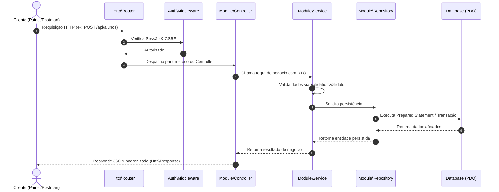

# Core & Infraestrutura da API

A camada **Core** concentra os componentes fundamentais e reutilizáveis de infraestrutura da API do **LTD-C.T**. Todos os módulos de negócio utilizam essas abstrações para persistência de dados, roteamento HTTP, validações, autenticação e resposta ao cliente.

Localização do código-fonte: [`api/core/`](../../api/core/)

---

## 🧭 Índice dos Componentes

| Componente | Diretório Fonte | Descrição | Documento |
| :--- | :--- | :--- | :--- |
| **Auth** | `api/core/Auth/` | Gerenciamento de sessão, proteção de rotas e verificação de perfil | [Ver doc](auth.md) |
| **Database** | `api/core/Database/` | Conexão singleton PDO, transações e queries preparadas | [Ver doc](database.md) |
| **Http** | `api/core/Http/` | Abstração de Request, Response JSON, Roteador REST e status HTTP | [Ver doc](http.md) |
| **Repository** | `api/core/Database/` | Padrão Repository base para abstração de consultas SQL | [Ver doc](repository.md) |
| **Services** | `api/core/Services/` | Classe base para camada de regras de negócio e transações | [Ver doc](services.md) |
| **DTO** | `api/core/DTO/` | Data Transfer Objects para tipagem e sanitização de dados | [Ver doc](dto.md) |
| **Validation** | `api/core/Validation/` | Motor de validação de regras de entrada e sanitização | [Ver doc](validation.md) |
| **DataTables** | `api/core/DataTables/` | Suporte a paginação, busca e ordenação server-side | [Ver doc](datatables.md) |
| **Docs** | `api/src/docs/` | Swagger UI e especificação OpenAPI 3.0.3 | [Ver doc](docs.md) |

---

## 🏛️ Fluxo de Execução no Core

---

[← Voltar para a Página Inicial da Wiki](../Home.md)