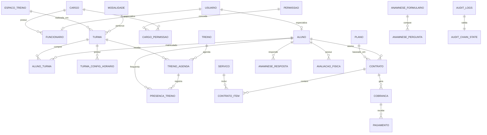

# Banco de Dados & Modelagem Relacional

O sistema **LTD-C.T** utiliza o banco de dados relacional **MySQL / MariaDB** (banco padrão: `db_centro_treinamento`), com charset `utf8mb4` e collation `utf8mb4_unicode_ci`.

A modelagem de dados foi desenhada para garantir integridade referencial, rastreabilidade completa por meio de uma cadeia de auditoria imutável e separação estrita de privilégios.

---

## 🗄️ Visão Geral dos Domínios de Dados

As tabelas do sistema estão agrupadas logicamente por áreas funcionais:

---

## 📋 Dicionário de Tabelas

### 1. Sistema, Acesso & Segurança
- **`usuario`**: Contas do sistema com e-mail único, hash de senha (`password_hash`), tipo (`admin`, `funcionario`, `aluno`) e status (`ativo`, `inativo`).
- **`cargo`**: Cargos atribuídos a funcionários (ex: Instrutor, Recepcionista, Gerente).
- **`permissao`**: Catálogo granular de ações e acessos permitidos no sistema.
- **`cargo_permissao`**: Tabela pivô associando permissões a cada cargo.
- **`password_resets`**: Tokens temporários de redefinição de senha com expiração.
- **`auth_rate_limits`**: Controle de tentativas de login para proteção contra força bruta.
- **`student_account_activations`**: Tokens para ativação inicial de cadastro de alunos.

### 2. Pessoas & Localização
- **`funcionario`**: Dados de colaboradores vinculados à conta de usuário e a um cargo.
- **`aluno`**: Cadastro de alunos com matrícula única, data de nascimento, observações e status.
- **`sequencia_matricula`**: Controle de numeração sequencial atômica para novas matrículas.
- **`contato`**: Telefones, e-mails de contato e tipo de vínculo.
- **`endereco`**: Logradouro, número, bairro, cidade, UF e CEP.

### 3. Treinamento & Agenda
- **`modalidade`**: Modalidades de atividades físicas (Cross Training, Musculação, Pilates, etc.).
- **`espaco_treino`**: Salas, boxes e áreas físicas com capacidade máxima de ocupação.
- **`treino`**: Definição pedagógica de exercícios, aquecimentos, WODs ou circuitos.
- **`turma`**: Definição de turmas com limite de vagas, professor responsável e espaço.
- **`turma_config_horario`**: Dias da semana, horário de início e fim de cada turma.
- **`aluno_turma`**: Matrícula do aluno na turma e controle de status de participação.
- **`treino_agenda`**: Ocorrência específica de um treino em uma data e horário de turma.
- **`presenca_treino`**: Registro de chamada (presença ou ausência) do aluno no treino agendado.

### 4. Saúde & Acompanhamento Físico
- **`anamnese_formulario`**: Fichas de saúde criadas pelo centro de treinamento.
- **`anamnese_pergunta`**: Questões de saúde (histórico médico, restrições, cirurgias, medicamentos).
- **`anamnese_opcao`**: Opções de resposta múltipla/seleção para perguntas fechadas.
- **`anamnese_resposta`**: Respostas fornecidas pelo aluno durante o preenchimento.
- **`avaliacao_fisica`**: Medidas corporais, peso, dobras cutâneas, IMC e testes de condicionamento.

### 5. Financeiro
- **`servico`**: Itens avulsos ou complementares comercializados.
- **`plano`**: Planos de assinatura (mensal, trimestral, semestral, anual).
- **`plano_item`**: Serviços incluídos em cada plano comercial.
- **`contrato`**: Contrato firmado com o aluno, com snapshot de valores, vigência e dia de vencimento.
- **`contrato_item`**: Composição de valores do contrato (imunes a alterações posteriores de planos).
- **`cobranca`**: Faturas geradas, competência, vencimento, valor original, desconto, acréscimos e status (`aberta`, `paga`, `vencida`, `cancelada`).
- **`pagamento`**: Pagamentos recebidos, com chave de idempotência obrigatória, método de pagamento, data e estorno.

### 6. Auditoria Criptográfica
- **`audit_logs`**: Tabela imutável que registra cada mutação (INSERT, UPDATE, DELETE) em formato de cadeia de blocos criptográfica (`previous_hash` e `current_hash` calculados com SHA-256).
- **`audit_chain_state`**: Mantém o último hash válido da cadeia para validação de integridade.

---

## 🛠️ Scripts SQL do Projeto

Os scripts SQL estão organizados no diretório [`docs/sql/`](../sql/):

| Diretório / Arquivo | Finalidade |
| :--- | :--- |
| **`sql/setup/banco.sql`** | Criação do banco de dados do zero, todas as tabelas e triggers de auditoria. |
| **`sql/auditoria_permissoes.sql`** | Concessão estrita de permissões para o usuário da aplicação (`ctt_app`). |
| **`sql/auditoria_operacoes.sql`** | Instalação e atualização dos gatilhos de auditoria imutável. |
| **`sql/migrations/`** | Alterações incrementais versionadas (ex: `financeiro_seguranca.sql`, `permissoes_sistema.sql`). |
| **`sql/testes/`** | Cargas de teste e seeds para desenvolvimento (`sistema_seed.sql`, `gerenciar_turma_seed.sql`). |

---

## 🔒 Princípio de Menor Privilégio (`ctt_app`)

Por razões de segurança e conformidade, a aplicação web **nunca** deve ser conectada com o usuário `root`.
- A aplicação utiliza o usuário `ctt_app`.
- Este usuário possui apenas `SELECT`, `INSERT`, `UPDATE` nas tabelas operacionais e `INSERT` em `audit_logs`.
- O usuário `ctt_app` **não tem permissão** de `DROP`, `ALTER`, `TRUNCATE` nem `DELETE/UPDATE` na tabela `audit_logs`.
- Para detalhes, consulte o guia de [Operação da Auditoria](../modules/auditoria_operacoes.md).
