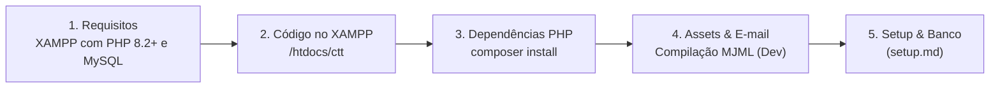

# Guia de Instalação e Preparação do Ambiente

Este guia descreve os pré-requisitos e os passos para preparar o ambiente e instalar o sistema **LTD - C.T (Centro de Treinamento)** em uma nova máquina utilizando o **XAMPP**.

O processo foi dividido entre o que é necessário para a **execução do sistema** (funcionamento da aplicação) e as ferramentas adicionais exigidas para o **ambiente de desenvolvimento**.

Depois de concluir as etapas deste guia, prossiga para o **[Guia de Setup da Aplicação (setup.md)](setup.md)** para criar a base de dados no MySQL, configurar as variáveis de ambiente e inicializar o sistema.

---

## 🗺️ Visão Geral do Processo



---

## 💻 1. Requisitos do Sistema

### A. Requisitos de Execução (Qualquer Máquina com XAMPP)
São os componentes do XAMPP obrigatórios para que a aplicação execute:

| Componente | Versão / Configuração | Finalidade |
| :--- | :--- | :--- |
| **XAMPP** | Versão com **PHP 8.2 ou superior** | Pacote integrado com Apache, PHP e MySQL |
| **Apache** | 2.4+ (incluso no XAMPP) | Servidor web local com suporte a `.htaccess` e `mod_rewrite` |
| **PHP** | **8.2+** (incluso no XAMPP) | Interpretador da linguagem |
| **Extensões PHP** | `pdo_mysql`, `mbstring`, `openssl`, `curl`, `fileinfo` | Módulos obrigatórios no `php.ini` |
| **MySQL / MariaDB** | 10.4+ / MySQL 8.0+ (incluso no XAMPP) | Banco de dados com suporte a Triggers e Stored Procedures |

### B. Requisitos Adicionais para Desenvolvimento (Ambiente Dev)
Se a nova máquina for utilizada por um desenvolvedor para programar, atualizar dependências ou rodar testes:

| Ferramenta | Versão Mínima | Finalidade |
| :--- | :--- | :--- |
| **Git** | 2.x+ | Clonagem e controle de versão do código |
| **Composer** | 2.x+ | Gerenciamento das bibliotecas PHP (`vlucas/phpdotenv`, `phpmailer`) |
| **Node.js & NPM** | Node 18+ LTS / NPM 9+ | Compilação de templates de e-mail responsivos em MJML |
| **Terminal / CLI** | PowerShell ou Prompt de Comando | Execução de comandos do PHP, Composer e scripts do sistema |

---

## ⚙️ 2. Configuração do XAMPP e Ferramentas

### 2.1 Adicionar o PHP do XAMPP ao PATH do Sistema
Por padrão, o instalador do XAMPP **não** adiciona o binário do PHP ao `PATH` do Windows. Sem essa configuração, comandos como `php` ou `composer` exibirão o erro `'php' não é reconhecido como comando interno`.

1. Identifique o diretório onde o XAMPP foi instalado (por exemplo, `C:\xampp` ou outra unidade de sua preferência).
2. O executável do PHP estará na subpasta `php` (ex: `C:\xampp\php`).
3. Adicione esse caminho ao `PATH` do usuário no Windows:
   - Abra o **PowerShell como Administrador** e execute:
     ```powershell
     # Substitua pelo caminho onde o seu XAMPP está instalado:
     [Environment]::SetEnvironmentVariable("Path", $env:Path + ";C:\xampp\php", "User")
     ```
   *(Ou adicione manualmente via: `Configurações do Windows` > `Sistema` > `Configurações avançadas` > `Variáveis de Ambiente` > selecione `Path` > `Editar` > adicione o caminho da pasta `php` do XAMPP).*
4. Feche e reabra o terminal e confirme:
   ```powershell
   php -v
   # Deve exibir PHP 8.2.x ou superior
   ```

### 2.2 Verificar Extensões no `php.ini` do XAMPP
No painel do XAMPP, clique no botão **Config** ao lado do Apache e selecione **PHP (php.ini)** (ou abra diretamente `<xampp>\php\php.ini`).

Certifique-se de que as seguintes extensões estão ativas (sem o ponto-e-vírgula `;` no início da linha):

```ini
extension=curl
extension=fileinfo
extension=mbstring
extension=openssl
extension=pdo_mysql

; Defina também o fuso horário padrão:
date.timezone = America/Sao_Paulo
```
Se fizer alterações, salve o arquivo e reinicie o Apache pelo painel do XAMPP.

### 2.3 Ativar o `mod_rewrite` no Apache do XAMPP
O sistema depende da reescrita de rotas amigáveis via arquivo `.htaccess`.

1. No painel do XAMPP, clique em **Config** no Apache e abra **Apache (httpd.conf)**.
2. Certifique-se de que a linha do `mod_rewrite` **não** possui `#` no início:
   ```apache
   LoadModule rewrite_module modules/mod_rewrite.so
   ```
3. Verifique se o bloco do diretório `htdocs` possui a permissão de sobrescrita ativada:
   ```apache
   <Directory ".../htdocs">
       AllowOverride All
       Require all granted
   </Directory>
   ```
4. Salve o arquivo e reinicie o Apache.

### 2.4 Instalar o Composer (Ambiente de Desenvolvimento)
1. Baixe o instalador oficial do Composer para Windows: [getcomposer.org](https://getcomposer.org/Composer-Setup.exe).
2. Durante a instalação, aponte para o executável `php.exe` da pasta do XAMPP (ex: `C:\xampp\php\php.exe`).
3. Conclua a instalação e reinicie o terminal. Verifique com:
   ```powershell
   composer --version
   ```

### 2.5 Instalar o Node.js e NPM (Ambiente de Desenvolvimento)
1. Baixe a versão LTS no site oficial: [nodejs.org](https://nodejs.org/).
2. Conclua a instalação padrão e verifique no terminal:
   ```powershell
   node -v
   npm -v
   ```

---

## 📥 3. Obtenção do Código e Localização no XAMPP

> [!IMPORTANT]
> **Nome da pasta no XAMPP:**
> O arquivo `.htaccess` e a configuração de rotas utilizam por padrão a base `/ctt/` (`RewriteBase /ctt/`).
> Portanto, o projeto deve ser clonado ou copiado dentro da pasta **`htdocs`** do seu XAMPP com o nome da pasta exatamente como **`ctt`**.

Abra o terminal na pasta `htdocs` do seu XAMPP:

```powershell
# Acesse a pasta htdocs do XAMPP
cd C:\xampp\htdocs

# Clone o repositório como 'ctt'
git clone <URL_DO_REPOSITORIO> ctt

# Entre no diretório do projeto
cd ctt
```

A estrutura no servidor ficará:
```text
<xampp>/htdocs/ctt/
├── admin/          # Painel administrativo
├── api/            # API PHP e regras de negócio
├── docs/           # Documentação e scripts SQL
├── public/         # Assets estáticos (CSS, JS, imagens)
├── tools/          # Ferramentas CLI e automações
├── .htaccess       # Regras de reescrita do Apache
├── .env.example    # Modelo de variáveis de ambiente
├── composer.json   # Dependências PHP
└── index.php       # Ponto de entrada da aplicação
```

---

## 📦 4. Instalação das Dependências PHP (Composer)

Na raiz do projeto (`htdocs/ctt`), instale as dependências declaradas no `composer.json` (`vlucas/phpdotenv` e `phpmailer/phpmailer`):

### Para Ambiente de Desenvolvimento:
```powershell
composer install
```

### Para Ambiente de Produção:
```powershell
composer install --no-dev --optimize-autoloader
```

O comando gerará o diretório `vendor/` e o arquivo `vendor/autoload.php`.

> [!NOTE]
> Se você estiver instalando um **pacote de produção já preparado** (onde a pasta `vendor/` já foi gerada e copiada junto), a execução do Composer não é necessária no computador final.

---

## 📧 5. Compilação dos Templates de E-mail (Ambiente de Desenvolvimento)

O sistema utiliza a biblioteca **MJML** para gerar e-mails responsivos de recuperação e ativação de senha. O template fonte fica em `tools/email/templates/password-reset.mjml` e precisa ser compilado para o arquivo HTML de produção: `api/src/auth/password-reset.html`.

No terminal da raiz do projeto:

```powershell
# 1. Instalar dependências da ferramenta de e-mail
npm install --prefix tools/email

# 2. Compilar o template MJML para o HTML de produção
npm run email:build --prefix tools/email
```

> [!IMPORTANT]
> Certifique-se de que o arquivo `api/src/auth/password-reset.html` foi criado. Ele é obrigatório para que os e-mails com links de acesso e redefinição de senha funcionem.
> 
> Durante alterações visuais no template, você pode usar o modo observador contínuo:
> ```powershell
> npm run email:watch --prefix tools/email
> ```

---

## 🛡️ 6. Permissões de Script no PowerShell (Windows)

Alguns scripts auxiliares do projeto utilizam PowerShell (`.ps1`), como a criação de administrador e o agendamento de tarefas. Por padrão, o Windows pode bloquear a execução de scripts locais.

Para liberar a execução na sessão atual do seu terminal:

```powershell
Set-ExecutionPolicy -Scope Process -ExecutionPolicy Bypass
```

---

## 🚀 7. Preparação de Pacote para Servidor de Produção

Se você for entregar ou publicar o sistema em uma máquina de uso final onde **não** haverá Git, Composer ou Node.js:

1. Na máquina de desenvolvimento, execute o build completo:
   ```powershell
   composer install --no-dev --optimize-autoloader
   npm install --prefix tools/email
   npm run email:build --prefix tools/email
   ```

2. **Arquivos que devem ser copiados para a pasta `htdocs/ctt` do XAMPP:**
   - `admin/`, `api/`, `public/`, `vendor/`
   - `tools/financeiro/`, `tools/sistema/`
   - `docs/setup.md`, `docs/sql/`
   - `index.php`, `.htaccess`, `.env.example`, `autoload.php`, `composer.json`, `composer.lock`
   - `api/src/auth/password-reset.html` (já compilado)

3. **Arquivos que NUNCA devem ser transferidos:**
   - `.env` local com credenciais da máquina de desenvolvimento;
   - Pasta `.git/`;
   - Diretórios `node_modules/`;
   - Arquivos `.log`, caches ou ferramentas de teste interno (`tools/testes/`).

---

## ❓ 8. Resolução de Problemas Comuns (Troubleshooting)

### 🔴 `'php'` ou `'composer'` não é reconhecido no terminal
- **Causa:** O caminho da pasta `php` do XAMPP não está na variável de ambiente `PATH`.
- **Solução:** Adicione o caminho do PHP do XAMPP (ex: `C:\xampp\php`) ao `PATH` do sistema e reabra o terminal.

### 🔴 `Fatal error: Class 'Dotenv\Dotenv' not found`
- **Causa:** A pasta `vendor/` não existe ou as dependências do Composer não foram instaladas.
- **Solução:** Execute `composer install` na raiz do projeto.

### 🔴 Apache ou MySQL não iniciam no painel do XAMPP
- **Causa:** Conflito de portas com outros softwares (ex: IIS/Skype na porta 80 ou 443; outra instância de MySQL rodando na porta 3306).
- **Solução:** Encerre os processos conflitantes ou ajuste a porta do Apache no `httpd.conf` para 8080 (se fizer isso, atualize o `APP_URL` no `.env` para `http://localhost:8080/ctt`).

### 🔴 Rotas retornam erro 404 ao navegar no painel administrativo ou na API
- **Causa 1:** O módulo `mod_rewrite` do Apache não está habilitado no `httpd.conf`.
- **Causa 2:** A diretiva `AllowOverride All` não está configurada para a pasta `htdocs`.
- **Causa 3:** O projeto foi clonado com nome de pasta diferente de `ctt` dentro de `htdocs`.

### 🔴 `Arquivo password-reset.html não encontrado`
- **Causa:** O template MJML não foi compilado com o comando do Node.js.
- **Solução:** Execute `npm run email:build --prefix tools/email`.

---

## ➡️ Próximo Passo

Com os pré-requisitos validados, o XAMPP configurado e as dependências instaladas, prossiga para a configuração do banco de dados e ativação do sistema:

👉 **[Continuar para o Guia de Setup da Aplicação (setup.md)](setup.md)**
