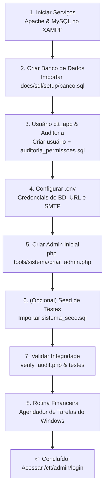

# Guia de Setup Inicial da Aplicação e Banco de Dados

Este procedimento deve ser executado logo após a conclusão do **[Guia de Instalação (instalacao.md)](instalacao.md)**. Ele orienta o provisionamento do banco de dados no MySQL do XAMPP, a configuração da conta de serviço com integridade de auditoria, o preenchimento do `.env`, a criação do administrador inicial e a validação operacional do sistema.

---

## 🗺️ Visão Geral do Setup



---

## 🚀 1. Iniciar os Serviços no Painel do XAMPP

1. Abra o **XAMPP Control Panel**.
2. Clique no botão **Start** para os módulos **Apache** e **MySQL**.
3. Ambos devem ficar com o indicador verde.
4. Para certificar-se de que o banco de dados está ativo, acesse o **phpMyAdmin** pelo navegador:
   ```text
   http://localhost/phpmyadmin
   ```

---

## 🗄️ 2. Criar e Estruturar o Banco de Dados

O banco de dados oficial do sistema chama-se **`db_centro_treinamento`** com conjunto de caracteres `utf8mb4_unicode_ci`.
O script com todas as tabelas, índices e triggers de integridade reside em:
[`docs/sql/setup/banco.sql`](sql/setup/banco.sql)

> [!WARNING]
> O script inicia com a instrução `DROP DATABASE IF EXISTS db_centro_treinamento;`.
> Execute este arquivo apenas para **novas instalações**. Nunca execute este script sobre uma base com dados que devam ser preservados.

### Opção A — Via Terminal do XAMPP / Linha de Comando (Recomendada)
Como o arquivo possui mais de 1.400 linhas e 100 KB, a importação via terminal é instantânea e livre de limites de upload do PHP:

```powershell
# Abra o PowerShell ou Prompt na raiz do projeto (htdocs/ctt):
# Se o MySQL estiver no PATH:
mysql -u root < docs/sql/setup/banco.sql

# Caso o binário do MySQL não esteja no PATH, chame diretamente do diretório do XAMPP:
# (Ajuste a unidade/caminho conforme a pasta do seu XAMPP):
& "C:\xampp\mysql\bin\mysql.exe" -u root -e "source docs/sql/setup/banco.sql"
```

*(Caso o seu usuário `root` do XAMPP possua senha, adicione o parâmetro `-p`).*

### Opção B — Via phpMyAdmin do XAMPP
1. Acesse `http://localhost/phpmyadmin`.
2. No menu superior, clique em **Importar** (Import).
3. Em **Escolher arquivo**, selecione o arquivo `docs/sql/setup/banco.sql` localizado na pasta do projeto.
4. Garanta que o conjunto de caracteres selecionado seja `utf-8`.
5. Role até o final da página e clique em **Executar** (Go).
6. Confirme que a base `db_centro_treinamento` foi criada com sucesso com todas as tabelas.

---

## 🛡️ 3. Criar a Conta de Serviço (`ctt_app`) e Configurar Permissões

> [!IMPORTANT]
> **Princípio do Menor Privilégio e Integridade da Auditoria:**
> O sistema implementa uma **trilha de auditoria criptográfica imutável** (estilo blockchain interna) com encadeamento de hashes SHA-256 gerados diretamente pelas Triggers do banco de dados.
> 
> A aplicação **NUNCA deve rodar como usuário `root`**. O usuário `root` não possui as restrições de permissão que protegem a cadeia de blocos de modificações manuais. A aplicação exige uma conta dedicada: **`ctt_app`**.

### 3.1 Criar o usuário `ctt_app` no MySQL
Acesse o MySQL como administrador (`root`) e execute:

```sql
CREATE USER 'ctt_app'@'localhost' IDENTIFIED BY 'DefinaSuaSenhaSeguraAqui!123';
```

*(Se a conta já existir de uma instalação anterior, altere a senha com: `ALTER USER 'ctt_app'@'localhost' IDENTIFIED BY 'DefinaSuaSenhaSeguraAqui!123';`)*

### 3.2 Aplicar as permissões cirúrgicas de auditoria
Execute o script [`docs/sql/auditoria_permissoes.sql`](sql/auditoria_permissoes.sql). Ele revoga privilégios excessivos anteriores e concede permissões exatas para a operação da API (SELECT, INSERT, UPDATE, DELETE nas tabelas de domínio e INSERT estrito no envelope de auditoria):

```powershell
# Via linha de comando (ou Terminal do XAMPP):
mysql -u root -e "source docs/sql/auditoria_permissoes.sql"

# Ou chamando o executável direto do XAMPP:
& "C:\xampp\mysql\bin\mysql.exe" -u root -e "source docs/sql/auditoria_permissoes.sql"
```

*(Ou copie e cole o conteúdo do arquivo na aba **SQL** do phpMyAdmin logado como `root`).*

---

## 📝 4. Configurar as Variáveis de Ambiente (`.env`)

Na raiz do projeto (`htdocs/ctt`), copie o modelo `.env.example` para `.env`:

```powershell
Copy-Item .env.example .env
```

Abra o arquivo `.env` gerado no seu editor e defina os parâmetros:

```env
# -----------------------------------------------------------------------------
# Aplicação
# -----------------------------------------------------------------------------
APP_URL=http://localhost/ctt
APP_ENV=development
APP_ALLOWED_ORIGIN=http://localhost
APP_TIMEZONE=America/Sao_Paulo

# -----------------------------------------------------------------------------
# Banco de Dados (Credenciais da conta restrita ctt_app)
# -----------------------------------------------------------------------------
DB_HOST=localhost
DB_PORT=3306
DB_DATABASE=db_centro_treinamento
DB_USERNAME=ctt_app
DB_PASSWORD=DefinaSuaSenhaSeguraAqui!123

# -----------------------------------------------------------------------------
# Envio de E-mails / SMTP (Recuperação e Ativação de Senhas)
# -----------------------------------------------------------------------------
MAIL_HOST=smtp.gmail.com
MAIL_PORT=587
MAIL_USERNAME=seu-email@gmail.com
MAIL_PASSWORD=sua-senha-de-aplicativo
MAIL_ENCRYPTION=tls
MAIL_FROM_ADDRESS=seu-email@gmail.com
MAIL_FROM_NAME="Cross C.T"
```

### Explicação dos parâmetros:
| Variável | Descrição |
| :--- | :--- |
| `APP_URL` | URL base do sistema no Apache (`http://localhost/ctt`) |
| `APP_ENV` | `development` para exibir mensagens de depuração ou `production` para operação real |
| `DB_HOST` / `DB_PORT` | Host e porta do MySQL no XAMPP (`localhost` e `3306`) |
| `DB_USERNAME` | Usuário exclusivo da aplicação (`ctt_app`) |
| `DB_PASSWORD` | Senha definida no Passo 3.1 para o `ctt_app` |
| `MAIL_*` | Configurações SMTP para envio de e-mails (consulte [Configuração de E-mail](modules/auth-email.md)) |

> [!TIP]
> Em desenvolvimento local, você pode usar ferramentas como **Mailpit**, **Mailtrap** ou configurar o Gmail utilizando uma **Senha de Aplicativo** (com verificação em 2 etapas habilitada).

---

## 👤 5. Criar o Administrador Inicial do Sistema

O banco de dados provisionado está limpo de senhas por questões de segurança. O sistema possui um utilitário CLI para criar o primeiro usuário Administrador respeitando as diretrizes de segurança da aplicação (`PasswordPolicy`).

### Modo Interativo (PowerShell / Terminal)
Execute na raiz do projeto:

```powershell
# Via script PowerShell:
& .\tools\sistema\criar_admin.ps1

# Ou chamando o PHP diretamente:
php tools/sistema/criar_admin.php
```
*(Caso o PowerShell bloqueie a execução do `.ps1`, rode antes: `Set-ExecutionPolicy -Scope Process -ExecutionPolicy Bypass`)*

O assistente solicitará:
1. **Nome e Sobrenome** do Administrador;
2. **E-mail de acesso** (login principal);
3. **Senha mestra** (mínimo de 12 caracteres, com letras maiúsculas, minúsculas, números e caracteres especiais).

### Modo Silencioso / Parâmetros Diretos (Automação)
```powershell
php tools/sistema/criar_admin.php --email="admin@ctt.local" --senha="AdminForte@2026!" --nome="Administrador"
```

---

## 🧪 6. (Opcional) Popular com Dados de Teste (Seed de Desenvolvimento)

Para máquinas de desenvolvimento onde você precisa de dados fictícios para testes (alunos, turmas, funcionários, planos e contratos):

```powershell
# Executar o seed de testes conectado como root no MySQL:
& "C:\xampp\mysql\bin\mysql.exe" -u root -e "source docs/sql/testes/sistema_seed.sql"
```

### Credenciais de Teste Disponíveis no Seed:
* **Senha padrão para todos os usuários de teste:** `Senha@Teste123`
* **Administrador de teste:** `admin@centrotreinamento.com`
* **Funcionários de teste:** `roberto.gerente@ctt.teste` (Gerente), `paulo.instrutor@ctt.teste` (Instrutor)
* **Alunos de teste (login por e-mail ou CPF):**
  - `ana.souza@ctt.teste` | CPF: `81000000001` (Em dia)
  - `bruno.lima@ctt.teste` | CPF: `81000000002` (Mensalidade vencida)

---

## 🔍 7. Validação de Integridade e Testes de Ambiente

Valide se a instalação e o ambiente estão 100% íntegros antes de liberar o uso:

### 7.1 Verificar a Cadeia de Auditoria
Recalcula os hashes SHA-256 e valida o encadeamento dos blocos de log:
```powershell
php tools/sistema/verify_audit.php
```
*Saída esperada:* `OK: cadeia integra; X registros verificados.`

### 7.2 Verificar o Schema do Módulo Financeiro
Valida chaves de idempotência e índices de cobrança:
```powershell
php tools/financeiro/financeiro_status.php
```
*Saída esperada:* `Estrutura financeira atualizada.`

### 7.3 Executar a Suíte de Testes
Valida as regras de negócio em memória:
```powershell
php tools/testes/financeiro/test_financeiro_rapido.php
# ou se o Composer estiver disponível:
composer test
```
*Saída esperada:* `OK: 6 grupos de testes financeiros rapidos aprovados.`

---

## ⏰ 8. Ativar a Rotina Financeira (Cobranças Automáticas)

A rotina financeira calcula competências devidas, atualiza contratos e gera faturas pendentes de forma idempotente.

### 8.1 Teste Manual de Execução
```powershell
php tools/financeiro/gerar_cobrancas.php
```

### 8.2 Agendamento da Rotina Diária no Windows (06:00)
Execute o assistente com privilégios de Administrador no PowerShell:

```powershell
& .\tools\financeiro\instalar_rotina_financeiro.ps1
```
Esse script cria no **Agendador de Tarefas do Windows** (`taskschd.msc`) a tarefa `CTT - Gerar cobrancas`, configurada para rodar diariamente às **06:00**, gravando o histórico de execuções no arquivo `tools/financeiro/financeiro_rotina.log`.

---

## 🌐 9. Acesso e Validação no Navegador

Abra o navegador e verifique os pontos de entrada do sistema:

1. **Painel Administrativo:**
   - **URL:** [http://localhost/ctt/admin/login](http://localhost/ctt/admin/login)
   - **Login:** O e-mail cadastrado no Passo 5 (ou `admin@centrotreinamento.com` se usou o seed).
   - **Senha:** A senha mestra definida no Passo 5 (ou `Senha@Teste123` com o seed).
   - Teste a navegação pelas telas de Alunos, Turmas, Treinos e Financeiro.

2. **Documentação Interativa da API (Swagger / OpenAPI):**
   - **URL:** [http://localhost/ctt/api/docs](http://localhost/ctt/api/docs) ou [http://localhost/ctt/docs](http://localhost/ctt/docs)
   - Valide se a interface interativa carrega as especificações dos endpoints.

---

## 🔄 10. Atualizações Futuras e Migrações

Para atualizar uma base já em funcionamento em uma nova versão:

1. Gere um backup do banco de dados no XAMPP:
   ```powershell
   & "C:\xampp\mysql\bin\mysqldump.exe" -u root db_centro_treinamento > backup_ctt.sql
   ```
2. Atualize o código-fonte (sem sobrescrever o arquivo `.env`).
3. Atualize as dependências: `composer install --no-dev --optimize-autoloader`.
4. Aplique as migrações incrementais necessárias localizadas em [`docs/sql/migrations/`](sql/migrations/).
5. Reaplique o script de permissões caso novas tabelas tenham sido adicionadas:
   ```powershell
   & "C:\xampp\mysql\bin\mysql.exe" -u root -e "source docs/sql/auditoria_permissoes.sql"
   ```
6. Execute `php tools/sistema/verify_audit.php` para atestar a continuidade da integridade.

---

## ❓ 11. Diagnóstico de Problemas Comuns (FAQ)

### 🔴 `Access denied for user 'ctt_app'@'localhost'`
- **Causa:** A senha configurada em `DB_PASSWORD` no `.env` não é a mesma definida no MySQL do XAMPP para o usuário `ctt_app`.
- **Solução:** Atualize a senha do usuário com `ALTER USER 'ctt_app'@'localhost' IDENTIFIED BY 'NovaSenha';` e ajuste o `.env`.

### 🔴 `SQLSTATE[42000]: Access denied to table ...`
- **Causa:** As permissões estritas de auditoria não foram concedidas à conta `ctt_app`.
- **Solução:** Execute `docs/sql/auditoria_permissoes.sql` conectado como `root`.

### 🔴 Hash de auditoria divergente ao rodar `verify_audit.php`
- **Causa:** Registros foram inseridos, alterados ou removidos manualmente na tabela `audit_logs` sem passar pelas Triggers.
- **Solução:** Em ambiente de testes/dev, reimporte `banco.sql` e execute o seed novamente.

---

## 📚 Documentação Complementar

- 🏗️ **[Arquitetura do Sistema](arquitetura.md)**: Conheça a divisão em camadas (Controller, Service, Repository, DTO).
- 🛡️ **[Cadeia de Auditoria & Blockchain Interna](modules/auditoria.md)**: Detalhamento técnico da imutabilidade dos logs.
- 💰 **[Módulo Financeiro](modules/financeiro.md)**: Regras de contratos, inadimplência e geração de faturas.
- 📖 **[Página Inicial da Wiki](Home.md)**: Índice completo da documentação do projeto.
